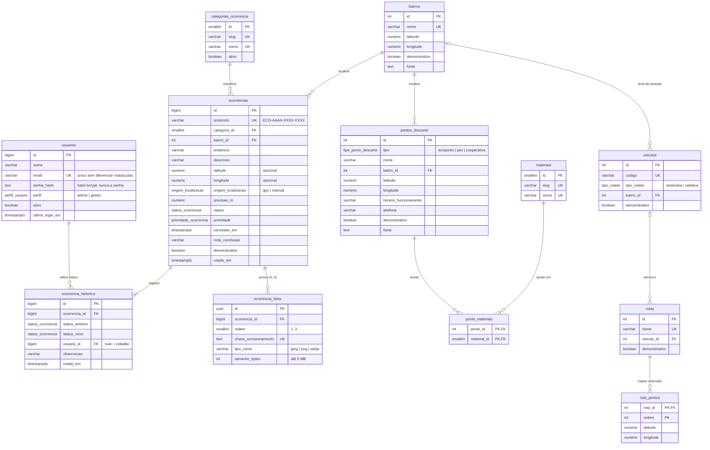

# 02 · Modelagem do banco de dados (PostgreSQL)

Scripts: [`database/`](../database). Instalação e testes: [`03-banco-de-dados.md`](03-banco-de-dados.md).

## 1. Decisões

| Decisão | Justificativa |
|---|---|
| **PostgreSQL 14+ sem extensões** | Funciona em qualquer instalação padrão (Windows, Linux, macOS) e em qualquer hospedagem gerenciada. A equipe não precisa instalar nada além do PostgreSQL. |
| **PostGIS não é usado nesta fase** | As consultas geográficas do escopo são os "3 pontos mais próximos" (dezenas de pontos) e os trajetos simulados. A função SQL `distancia_km` (fórmula de Haversine) resolve isso com precisão de metros, sem índice espacial. O PostGIS só passa a compensar com milhares de pontos ou com consultas de área (ex.: ocorrências dentro de um polígono). A migração seria simples: uma nova migração com uma coluna `geography` gerada a partir de `latitude`/`longitude` e um índice GiST. |
| **Docker não é necessário** | Sem extensões, a instalação nativa do PostgreSQL basta, e muitas máquinas Windows não têm virtualização habilitada. Quem já usa Docker pode usar a imagem oficial `postgres:16` (ver doc 03). |
| Tipos `ENUM` com valores ASCII (`em_analise`) | São estáveis para a API; os rótulos em português ("Em análise") ficam na interface. |
| Protocolo aleatório gerado no banco (`gerar_protocolo()`) | Formato `ECO-AAAA-XXXX-XXXX` com cerca de 1,1 trilhão de combinações, o que impede adivinhar o protocolo de terceiros. |
| Cidadão anônimo | `ocorrencias` não tem nome, e-mail, telefone nem IP. O cidadão acompanha a ocorrência pelo protocolo. |
| Fotos fora do banco | O banco guarda só a referência (`chave_armazenamento`), o tipo e o tamanho. Os binários ficam no disco ou num armazenamento de objetos. |
| Coluna `demonstrativo` + `fonte` | Separa dado simulado de dado com fonte verificável. Bairros e pontos marcados como não demonstrativos exigem `fonte` (restrição `CHECK`). |
| Sem usuários nos scripts | Nenhuma senha é versionada. O primeiro administrador será criado por um comando da API (CP2). |
| Migrações versionadas em SQL puro | Ficam legíveis na avaliação. A tabela `schema_migrations` registra o que foi aplicado e impede rodar duas vezes. |

## 2. Diagrama entidade-relacionamento



## 3. Regras de integridade principais

| Regra | Onde |
|---|---|
| Protocolo único e no formato `ECO-AAAA-XXXX-XXXX` (sem 0, 1, I, O) | `UNIQUE` + `CHECK` em `ocorrencias.protocolo` |
| Status só entre os 4 do protótipo; "Improcedente" não existe | enum `status_ocorrencia` |
| `concluido_em` preenchido **se e somente se** status = `concluida`; nota só em concluída | `CHECK` |
| Latitude e longitude andam juntas; a origem (`gps`/`manual`) existe só se houver coordenada | `CHECK` |
| No máximo 3 fotos por ocorrência, até 5 MB, só JPEG/PNG/WEBP | `CHECK (ordem 1..3)` + `UNIQUE (ocorrencia_id, ordem)` + `CHECK`s |
| O histórico sempre muda de status | `CHECK (status_anterior IS DISTINCT FROM status_novo)` |
| Excluir uma ocorrência remove fotos e histórico | `ON DELETE CASCADE` |
| Excluir um usuário preserva o histórico (autor fica nulo) | `ON DELETE SET NULL` |
| Dado "oficial" exige fonte | `CHECK (demonstrativo OR fonte IS NOT NULL)` |
| `senha_hash` não aceita senha curta em texto puro | `CHECK (length >= 50)` (um hash bcrypt tem 60 caracteres) |

**Transições de status** (serão validadas na API, CP2, e cada uma gera uma linha no histórico):

```
recebida ⇄ em_analise ⇄ equipe_designada      (a gestão pode avançar ou corrigir entre estados ativos, como no protótipo)
qualquer estado ativo → concluida              (ação "Concluir", com nota opcional; grava concluido_em)
concluida → em_analise                         (reabertura; limpa concluido_em e nota_conclusao)
```

## 4. O que a consulta pública por protocolo expõe

Só: protocolo, categoria, bairro, status, datas e a linha do tempo de status.

Ficam de fora: descrição, endereço exato, coordenadas, fotos, prioridade, observações internas e identificação de servidores, porque o cidadão pode ter digitado dados pessoais na descrição. Sem login, ninguém altera nada pelo protocolo; alterações só pela gestão autenticada (CP2). A API terá limite de tentativas na consulta para impedir varredura.

## 5. Índices

| Índice | Atende |
|---|---|
| `ocorrencias (status, criado_em DESC)` | Fila ativa/histórico da gestão, paginada |
| `ocorrencias (bairro_id)`, `(categoria_id)` | Filtros e visão por bairro |
| `ocorrencia_historico (ocorrencia_id, criado_em)` | Linha do tempo |
| `pontos_descarte (tipo) WHERE ativo`, `ponto_materiais (material_id)` | Filtros do guia de reciclagem |
| `usuarios (lower(email))` único | Login sem diferenciar maiúsculas |
| PK/UNIQUE (protocolo, slugs, códigos) | Buscas diretas |

## 6. Dicionário de status e prioridades (banco → interface)

| Banco | Interface |
|---|---|
| `recebida` | Recebida |
| `em_analise` | Em análise |
| `equipe_designada` | Equipe designada |
| `concluida` | Concluída |
| `urgente` / `alta` / `media` / `baixa` | Urgente / Alta / Média / Baixa |
